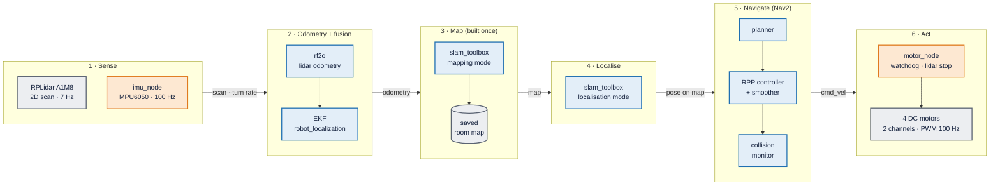
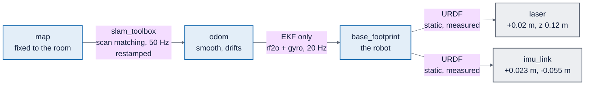

# CA3 presentation: slide outline (low-cost SLAM robot)

Status: **v5, 2026-11-11**: Chloe's teach-first plan as the base (background → pipeline → implementation and results), with v4's additions: a paper comparison slide (1.6), a separate analysis slide (3.9), "Our take" lines, the live map-accuracy numbers, the `dry_run` bug, and v4's backup, Q&A and figure sources. Each challenge in Section 3 points back to the background slide that explains it (← 1.n). Only work that ran on the robot goes on a slide. The delivery mission is dropped (not achieved). v4 (per-block layout) is in git history at 608b6be.

Brief (NTULearn): 10-15 min + 5 min Q&A, Thu Week 13 9:30-12:30; overview, state of the art, product/paper comparison, brief technical information, future trends; **most importantly our insights**; videos/animations ≤ 2 min in total; slides and report due end of Week 13; peer assessment confidential.

Presenters: **Y** Yujie (Section 1), **C** Chloe (pipeline, hardware, motors, result, lessons), **S** Sherman (SLAM, localisation, navigation, analysis). Each person presents their own part.

Rules (AGENTS.md): every number is *measured*, *fitted* or *brief default* and points to its test_log row or notes block; papers only from [`literature_notes.md`](literature_notes.md) (verified), products only with a source ("to check"); no live demo.

**Title:** *A Low-Cost Autonomous SLAM Robot: What It Took to Map a Room and Navigate It*
**Aim:** how can we apply what we learned in the course to build a low-cost autonomous driving robot?
**Main claim:** the SLAM and navigation software came as packages and worked. Most of the work was making cheap hardware and a slow computer meet their assumptions.

## 1. Slide table

Full implementation detail, every number with its command, and logs per block: [`implementation_by_block.md`](implementation_by_block.md). On every Section 3 slide the pipeline sits small in the corner with the current block highlighted (`figures/2026-11-11_pipeline_block1.png` … `block6.png`), so the audience always knows where they are.

| # | Section | Time | Who | Headline (the claim) | Visual | Speaker notes (numbers with source) |
| --- | --- | --- | --- | --- | --- | --- |
| T | Title | 0:00-0:30 | Y | We built a low-cost robot that maps a room and then drives itself around a box | Clip V1 `figures/2026-11-10_V1_box_2x.mp4` (first 40 s of the box video at 2x = 20 s) + small `figures/2026-11-11_robot_labelled.png`, so the robot is seen before 3.6 | - Aim (above); parts: Pi 4B, RPLidar A1M8, MPU6050 IMU, four DC gear motors on an L298N driver (left pair and right pair each on one channel), **no wheel encoders** - Hook: "by the end, this robot plans its own path around a box" |
| 1.1 | Background | 0:30-1:20 | Y | Every autonomous vehicle answers three questions: what is around me, where am I, how do I get there | `figures/2026-11-11_drift_vs_slam.gif` (14 s) + `figures/2026-11-11_pose_graph.png` | - The first two are SLAM: a map needs a known position, a position needs a map; SLAM estimates both together - The third is navigation: plan a path, then follow it - GIF: odometry alone drifts up to 0.46 m off the SLAM path - Pose graph: our lap, 63 nodes, 6 revisits where loop closure can correct |
| 1.2 | Background | 1:20-2:05 | Y | A 2D lidar sees one slice of the room; two algorithms turn it into motion and a map | `figures/2026-11-11_lidar_plane.png` (side view: one plane, what it sees and misses) | - Lidar: a laser spins 360° about 7 times a second; one horizontal slice: walls and legs, not table tops - **rf2o** [J16]: how far did we move, by comparing two scans in a row; stands in for wheel encoders - **SLAM Toolbox** [MJ21]: scan matching, pose graph, loop closure; graph-based SLAM is the standard for 2D lidar [R25] - Weaknesses (we come back to them): no echo from glass or dark surfaces (measured on 3.1); **rf2o assumes everything it sees is standing still**; at 7 Hz the robot moves during one sweep [S23] |
| 1.3 | Background | 2:05-2:50 | Y | The IMU feels every turn; an Extended Kalman Filter combines it with the lidar | `figures/2026-11-11_fusion_flow.png` | - Gyro = turn rate, accelerometer = acceleration; good at turns and blind to the room, but drifts and gives no position on its own - EKF: predict where you are, correct with each measurement, trust each sensor by its noise (*covariance*) - Ours: robot_localization fuses rf2o's forward speed and turn rate with the gyro's turn rate; the measured numbers are on 3.1 |
| 1.4 | Background | 2:50-3:30 | Y | Without encoders, the motors run open loop, and below a certain duty they do not move at all | `figures/2026-11-11_motor_drive.png` (H-bridge + four wheels as two sides) | - L298N H-bridge: two pins set direction, PWM duty sets average voltage and so speed - Differential drive: four wheels, but each side's pair is wired to one channel, so it is driven as two sides; each side v ∓ ω × track / 2. Skid steer turns by scraping the wheels sideways, so the taped track of 0.156 m (*measured*, notes 2026-10-31) is only a first guess for the effective one (not fitted) - No encoders = open loop: duty-to-speed must be calibrated - **Stall floor**: static friction, the wheels do not turn below a certain duty (back on 3.5, 3.7) |
| 1.5 | Background | 3:30-4:20 | Y | Nav2 gets the robot from A to B: costmap, planner, controller, safety | `figures/2026-11-11_nav2_concept.png` (costmap, path, lookahead point; path computed offline) + small `figures/2026-11-11_safety_zones.png` | - Costmap: saved map + live lidar obstacles, inflated 0.25 m - Planner: NavFn (Dijkstra) - Controller: Regulated Pure Pursuit, steers to a point 0.2-0.4 m ahead, slows near obstacles and the goal - Safety: collision monitor (stop zone 0.20 m), plus the motor node's lidar stop and 0.5 s watchdog - Checkers: goal reached within 0.10 m; progress 0.5 m in 10 s (`nav2_params.yaml`, *brief default* or *tuned*) |
| 1.6 | Background: literature | 4:20-5:05 | Y | Published work used far better sensors and desktop replays; ours had to be measured live | native slide table (no image) | - K26: same stack as ours (rf2o + EKF + SLAM Toolbox, no encoders), Ouster OS-1 cut to 2D, results replayed on a desktop; runs repeat within 0.20-0.23 m. Ours: three replays of one recording gave 0.68 / 0.59 / 0.53 m on the Pi, so we tested live - M26: Hokuyo + MicroStrain + encoders on a PR2; fusing the IMU cut odometry error 60-75 % before SLAM, ≈0 after. Ours: the gyro carries the heading (360.2° vs 352.9°) - Y21: Hokuyo at 40 Hz; people in the scan raise map error 5.9 → 80 cm. Ours: one stage earlier, in odometry (3.4) - S23: low-rate 2D lidars skew scans while moving. Ours: at 7 Hz the robot turns about 8° within one scan at 1 rad/s - Ours: A1M8 7.05 Hz, MPU6050, no encoders, Pi 4 at load 13-22 |
| 2.1 | Planned pipeline | 5:05-5:50 | S | Six blocks, left to right: sense, odometry, map, localise, navigate, act | `figures/2026-11-11_pipeline.png` (simpler alternative `docs/img/pipeline-simple.png`) | - ROS 2 Jazzy: programs are *nodes*, data on named *topics* (`/scan`, `/imu/data`, `/cmd_vel`), TF tracks every frame - Orange = written by us (IMU node, motor node, URDF, launch files); blue = packages (rf2o, EKF, SLAM Toolbox, Nav2) (D5) - Foxglove to watch live, rosbag2 to record |
| 3.1 | Implementation: sensing + fusion | 5:50-6:40 | S | We made two cheap sensors trustworthy: measured them, mounted them, and fused them | `figures/2026-11-11_scan_gaps.png` + `figures/2026-11-10_turn_gyro_vs_rf2o.png` | **Built:** rplidar driver with `angle_compensate` (fixed 720 beams); our `imu_node` (MPU6050 over I2C, 100 Hz, 3 s still calibration at start, `/imu_node/recalibrate` service); lidar and IMU positions taped into the URDF (lidar 2 cm forward, 12 cm up; IMU 2.3 cm forward, 5.5 cm right); EKF at 20 Hz as the only publisher of the robot's position (rf2o `publish_tf: false`: two publishers make the map spin) **Measured (← 1.2, 1.3):** lidar 7.05 Hz, 26-29 % of raw pings return nothing, 9 % of directions in one published scan; gaps follow the room, not the lidar (white-box test); gyro z std 0.00175 rad/s at rest; hand turn: gyro 360.2°, rf2o 352.9°; rf2o hand tests -2 % turn, -3.8 % push; 0.962 m on a 1.000 m push **Challenges → fix:** rf2o reports zero uncertainty, so the EKF cannot weigh it → covariance relay + variances fitted from the hand tests; EKF missed its 30 Hz rate under camera load → 20 Hz; fast turns under-read 9-15 %, [S23] scan skew a likely part (hypothesis) |
| 3.2 | Implementation: mapping | 6:40-7:25 | S | One hand-pushed lap made the map, once the scans had a fixed size | `figures/2026-11-10_map_build.gif` (14 s) + `figures/2026-11-11_beam_count.png` | - One lap pushed by hand round a taped loop, about 7 min (`mapping.launch.py`), settings frozen in `slam_mapping.yaml` after a parameter sweep (`figures/2026-11-11_slam_sweep.png`, test_log 2026-10-31 "5.5 sweep", replay) - **Challenge:** `LaserRangeScan contains 1041 range readings, expected 931`: 223 scans rejected, a 184 x 112 fan instead of a room; the driver sent a different number of beams each sweep → `angle_compensate`, fixed 720 beams |
| 3.3 | Results: map + localisation | 7:25-8:15 | S | Loop closure made the map usable; localisation finds the robot within 3 cm if it starts within 20° | `figures/2026-11-11_map_overlay.png` (same scans placed by SLAM and by odometry, overlaid) + `figures/2026-11-11_wrong_start.png`; small `figures/2026-11-11_home_move.png` | - Map 317 x 233 cells at 5 cm, 65.5 m² free - No ground truth, so we built one: the lap starts and ends on one taped mark. **Live:** start-end gap 0.20 m with SLAM vs 0.36 m odometry only. Replay sweep (label as replay): 0.109 m with loop closure vs 0.658 m without (← 1.2) - On the home mark: scan-to-map median 2.6 cm - **Challenges:** 30 cm / 20° wrong start recovers, 31° never: the matcher searches ±20° → taped home mark; old home 0.21 m from furniture → moved to 0.67 m clearance |
| 3.4 | Results: the surprise | 8:15-9:05 | S | A person walking behind the robot fooled the odometry | `figures/2026-11-11_oi8_ladder.png` (suspects ruled out, cause, fix), then `figures/2026-11-10_oi8_person_behind.gif` (15 s) | - A 1 m push read 24-25 % of the true distance - Five suspects over three days: ruled out scan format (720 vs 1045 beams), scan rate and CPU load; repaired the offline replay rig until it reproduced the live under-read exactly (23.8 %); settled by counting scan points behind the robot: 127-152 during the bad pushes vs 16-18 on good ones - rf2o assumes everything it sees is still (← 1.2), so a person moving with the robot says "we barely moved" - [Y21] saw people raise map error 5.9 → 80 cm; we saw it one stage earlier - Fix, **offline only**: ignore returns within 0.6 m → 99.5 % |
| 3.5 | Implementation: navigation | 9:05-9:55 | S | Nav2 failed seven ways before reaching a goal | `figures/2026-11-11_nav_goal_attempts.png` | - Silent mismatch: Nav2 sent `Twist`, motor node listens for `TwistStamped`; wheels never moved, no error - Slow computer: two server timeouts 20 → 1000 ms; `Transform data too old`: slam_toolbox stamps its correction by the last scan, ≥ 0.5 s apart at load 13-22 → `restamp_tf`, tolerances 0.5 s - Stall floor (← 1.4): slowdown zone asked for 0.045 m/s → removed; turn and approach speeds ≥ 0.10 m/s - Drove backwards → reversing off; final turn stalled → any heading accepted - (Home mark move is on 3.3) |
| 3.6 | Implementation: hardware + power | 9:55-10:35 | C | To drive itself, the robot first needed stable power | `figures/2026-11-11_robot_labelled.png` (top view; side view `2026-11-11_robot_side.jpg`) + `figures/2026-11-10_power.png`; small `safety_zones.png` | - Pi 4B, A1M8 on top, MPU6050, L298N + 4 DC gear motors (left pair and right pair wired together, so two channels), four-wheel skid steer, motor battery, Pi power bank, motor switch = kill switch - Sensor positions taped into the URDF: lidar 2 cm ahead of centre, 12 cm up - No screen: SSH over Tailscale, Foxglove in the browser - **Challenge:** Pi rebooted and Nav2 crashed: under-voltage in 67.5 % of samples on the wall supply → power bank, 0 of 60; a loose motor wire rebooted the Pi twice - Lidar stop 0.20 m, tested at 0.155 m |
| 3.7 | Implementation: motors | 10:35-11:25 | C | The wheels stall below 0.10 m/s and the battery lasts one run | `figures/2026-11-10_motor_curve.png` + `figures/2026-11-10_straights.png` (lidar-odometry distance of the 11-10 runs, tape in the legend; the 0.96 m run is from 11-09 and not in it) | - First drive: curved 35-40°, would not start slowly, then overshot 2-3x when the Pi was busy: 1 kHz software PWM late under load → 100 Hz - Calibration (← 1.4): speed = 2.46 x (duty - 0.078) (*fitted*); stall below about 0.10 m/s → kick duty 0.30 for 0.35 s from rest - 1 m straights 0.96, 1.06, 1.16 m: 2 of 3 within ±10 cm - Battery fades within a run 0.84 → 0.74 → 0.38 m → cycled between runs - **Silent failure:** `dry_run` was never passed on, so "live" runs drove nothing and nothing complained |
| 3.8 | Result | 11:25-12:25 | C | It works: a goal 1.5 m away reached on its own, and a box driven around | Clip V2 `figures/2026-11-10_V2_box_full.mp4` (45 s, 1x) + `figures/2026-11-11_goal_on_map.png` | - `Goal succeeded` after 93 s, (-1.35, -0.29) → (-2.67, 0.42) (`bt_navigator` log 2026-11-10) - Box about 1 m ahead, path about 3 m (**by eye, tape before presenting**) - 1 success of 8 goals that evening (`bt_navigator` logs, `GOALS_EVENING` in slide_figs.py); the others cancelled by hand |
| 3.9 | Analysis | 12:25-13:10 | C | Almost every challenge was integration, and most were surprises | `figures/2026-11-10_challenge_timeline.png` + `figures/2026-11-11_root_cause.png` | - Of 14 challenges, 13 were hardware, computer load, interfaces or process; 1 was an algorithm's assumption (the person) (**agree one count**: 2 if the ±20° matcher window counts) - 8 of 14 unexpected (10 counting "partly"; section 7 table): the person, the replays, the silent failures (`Twist`, `dry_run`), PWM under CPU load - Replays disagreed (0.68 / 0.59 / 0.53 m), so every result here is live |
| 3.10 | Lessons, limits, future | 13:10-13:55 | C | What we learned, what limits us, what we would do next | Two columns | **Lessons:** integration was the hard part; measure physical limits on day one (stall floor, power, CPU); test live, not on replays; design a ground truth when you have none (the taped loop); make silent failures loud **Limits:** no encoders (open loop); one navigation success; a slow Pi (load 13-22); one-plane lidar misses glass and table tops; not tested with people moving during navigation **Future:** wheel encoders; hardware PWM; a faster computer; a live `laser_filters` people cut or people tracking [Y21]; scan de-skewing [S23]; slam_toolbox vs AMCL |
| Close | Verdict | 13:55-14:20 | C | A low-cost robot can map a room and navigate it on its own, once every physical limit is measured and designed around | One sentence, large type | Thank you; questions |
| B1 | Backup | Q&A | all | Stack, TF tree, frozen config | TF tree, key YAML values | If asked |
| B2 | Backup | Q&A | all | Every number with its command | Table from test_log | If asked |
| B3 | Backup | Q&A | S | The person behind and the replays, in numbers | `oi8_and_replay_bars.png` | If asked |
| B4 | Backup | Q&A | S | Planner paths on the saved map | `results/maps/2026-11-08_planner_paths.png` | If asked |
| B5 | Backup | Q&A | all | Every challenge, in detail | Section 7 table; [`slam_challenges.md`](slam_challenges.md) | If asked: configure delay at start, `map_start_pose`, covariance relay, lidar start hang |
| B6 | Backup | Q&A | S | Every node and topic | `figures/2026-11-11_pipeline_detailed.png` | If asked |

Timing: 20 slides end at 14:20 (0:40 slack). Order follows the pipeline, two handovers: Y 0:00-5:05 (5:05, background: concepts only, no measured numbers); S 5:05-9:55 (4:50, pipeline blocks 1-5: 2.1, 3.1 sensing + fusion, 3.2 mapping, 3.3 map + localisation, 3.4 person, 3.5 navigation); C 9:55-14:20 (4:25, block 6 act: 3.6 hardware + power, 3.7 motors, then result, analysis, lessons, close).

## 2. Video and animation budget (≤ 120 s)

| Clip | Slide | Seconds | Source |
| --- | --- | --- | --- |
| V1 around the box, first 40 s at 2x | T | 20 | `figures/2026-11-10_V1_box_2x.mp4` from IMG_8217.MOV (45.5 s, 1280x720), muted |
| `drift_vs_slam.gif` | 1.1 | 14 | `tools/analysis/slide_figs.py` |
| `map_build.gif` (from first motion, 8 fps) | 3.2 | 14 | same |
| `oi8_person_behind.gif` | 3.4 | 15 | same |
| V2 full box run at 1x | 3.8 | 45 | `figures/2026-11-10_V2_box_full.mp4`, muted |
| **Total** | | **108** | 12 s spare; if tight, show the drift still instead of its GIF |

Local files, muted, captioned. No live demo.

## 3. Our take lines (≤ 20 words, fixed box at the bottom)

| Slide | Our take |
| --- | --- |
| 1.6 | Published numbers come from good sensors and desktop replays; a cheap robot has to be measured live. |
| 3.4 | Without encoders the lidar is the odometry, and anything moving with the robot fools it. |
| 3.5 | Navigation defaults assume motors that can crawl and a fast computer; ours had neither. |
| 3.8 | One success proves the loop closes, not that it is reliable. |
| 3.9 | Package defaults assume better hardware, so every default had to be re-earned. |

## 4. Gaps to close before rehearsal

- [ ] Tape numbers for the box run (distance, sideways drift, box position and size); which launch it was (3.8)
- [ ] Add the 2026-11-10 evening Nav2 runs to `docs/test_log.md` and a notes entry (3.5, 3.8 cite them; rule 6)
- [x] Robot photo, labelled (3.6): `figures/2026-11-11_robot_labelled.png` (front direction assumed from lidar position, check)
- [ ] BOM cost if quoted
- [ ] Box video: confirm it is the `Goal succeeded` run (video 45 s, log says 93 s) and whether the trailing cable is the Pi's power (3.6 says power bank)
- [ ] One integration-vs-algorithm count, used on 3.9 and in section 7
- [ ] First "fan" map image from the Pi (`~/maps/2026-10-31_room*`) for 3.2
- [ ] Sensor specs from datasheets (A1M8, MPU6050) if 1.2 or 1.3 quote any; else measured values only
- [x] Pipeline PNG and six highlighted copies (`figures/2026-11-11_pipeline*.png`)
- [x] Drift vs SLAM, pose graph, scan gaps, sweep, beam count, wrong start, goal attempts, root cause, safety zones, goal on map: `figures/2026-11-11_*`

## 5. Q&A prep

| # | Question | Draft answer |
| --- | --- | --- |
| 1 | Why only one successful goal? | The evening went on finding and fixing faults (slides 3.7, 3.5); once the loop closed we had a video and the battery gave about one run per charge. We claim the loop works, not a success rate. |
| 2 | Why no wheel encoders? | The kit did not have them; lidar odometry plus the IMU stood in, as in [K26]. OI-8 shows the cost, and encoders are first on the roadmap. |
| 3 | Why packages, not your own code? | D5: the brief allows them, and the hard part turned out to be integration anyway. Our own EKF and planner stay a documented fallback (`docs/system/07_ros_stack.md`). |
| 4 | Is a 2D lidar safe around people? | Not on its own: one plane only, 26-29 % no-echo on this unit. Mitigations: 0.15 m/s cap, 0.20 m lidar stop (tested), watchdog, physical kill switch. |
| 5 | How does this compare to a road AV? | Same SLAM loop, far smaller world: a mapped room at 0.15 m/s, 2D instead of 3D lidar. What transfers is the structure and the integration lessons. |
| 6 | What would you do differently? | Measure the motors' stall floor and the power supply on day one, and keep people out of the scan in odometry tests. Both cost days later. |
| 7 | Why did replay differ from live? | The Pi is CPU-bound; rf2o's work lands at different times on each replay (spread -12 %, about 71 % of live); slowing playback did not fix it. |
| 8 | Wasn't this meant to be a delivery robot? | It started as one. A delivery loop needs repeated goals and we reached one goal on the last evening, so we report what works: mapping, localisation and one navigation goal around an obstacle. |
| 10 | How did you judge the map without ground truth? | The lap starts and ends on one taped mark, so the start-end gap measures the error: live 0.20 m with SLAM vs 0.36 m odometry only; on replay 0.109 m over 42 m with loop closure vs 0.658 m without. [F17] also proposes metrics for judging 2D maps against each other (to check which, full text not read). |
| 9 | Did you replicate the papers? | No: our hardware and setup differ too much (slide 1.6). We compare directions: M26's IMU gain, K26's replay method, Y21's people effect, each against something we measured. |

## 6. Design notes

- One idea per slide; the headline is the claim, the figure its evidence, notes the rest.
- Figures carry no titles or source lines: the slide headline is the title, the source goes in one small footer line on the slide.
- Every number carries a provenance tag (*measured*, *fitted*, *brief default*, *by eye*).
- Fixed "Our take" box, same place on every slide that has one. Colour-blind-safe palette; captions on clips.

## 7. Key challenges and checkpoints

From `notes/notes.md`, `docs/test_log.md`, `docs/CA3.md` (OI-n) and `docs/system/06_troubleshooting.md`.

### Checkpoints reached

| Date | Checkpoint | Proof |
| --- | --- | --- |
| 2026-10-21 | Lidar bring-up on the first Pi | notes 2026-10-20/21 |
| 2026-10-22 | Stack decided: ROS 2 packages, not our own maths (D5); stack installed on the new Pi | notes 2026-10-22 "D5" |
| 2026-10-31 | CP0 platform up: robot built, lidar and IMU measured into the URDF | test_log 2026-10-30/31 |
| 2026-10-31 | First room map saved, SLAM settings frozen | `results/maps/2026-10-31_room2.png` |
| 2026-11-01 | CP1 localisation on the map, wrong start 30 cm / 20° recovers | test_log 2026-11-01 "6.4" |
| 2026-11-03 | CP2 OI-8 explained (person behind the robot) | `evidence/lidar/2026-11-03_oi8_*.txt` |
| 2026-11-09 | Motors live, lidar stop tested, first 1 m straight (0.96 m) | test_log 2026-11-09 |
| 2026-11-10 | CP5 robot drives: 2 of 3 straights; Pi power stable | test_log 2026-11-10 CP5 rows |
| 2026-11-10 | Nav2 goal succeeded (1.5 m, 93 s); robot drives around a box | `bt_navigator` log, video (test_log row to add) |

### Challenges

Root cause groups (slide 3.9): **HW** cheap hardware, **CPU** loaded computer, **IF** silent interface mismatch, **ENV** environment/algorithm assumption, **PL** platform/process. Expected = we planned for something like it; unexpected ones are on slide 3.9. Slide column: v5 numbering.

| # | Date | Symptom | Root cause | How we found it | Fix / status | Group | Expected? | Slide |
| --- | --- | --- | --- | --- | --- | --- | --- | --- |
| C1 | 10-21 | Lidar returns a distance for only a third of pings | Room surfaces (glass, dark): gaps move with the scene | White box test; near-return bins move between bags (OI-4) | Accepted; mapped anyway (26-29 % no-echo) | HW | yes | 3.1 |
| C2 | 10-22 | Brief's Pi offline; new Pi stopped answering SSH | Old box gone; new one set up from scratch | `tailscale status`, `nc -z` | Moved to `sherm-raspi` over Tailscale | PL | no | B5 |
| C3 | 10-22 | Plan said write our own EKF, A*, pure pursuit | Too much maths for the time | Decision review | D5: ROS 2 packages, our code is glue | PL | yes | 2.1 |
| C4 | 10-30 | slam_toolbox dropped every scan: `LaserRangeScan contains 1041 range readings, expected 931` | Varying beam count with `angle_compensate` off | Error text, beam counts per bag | `angle_compensate` true (720 beams) | IF | no | 3.2 |
| C5 | 11-01 | Launch looks up but no `/scan` | Lidar restarted too soon, or two launches overlapped | Repeated starts; process list | Wait 20 s, one launch at a time (OI-6) | HW | no | B5 |
| C6 | 11-01 to 11-03 | Odometry read 24-28 % of a hand push | A person behind the robot moved with it; rf2o assumes a still scene | Ruled out format, rate, CPU; counted points behind the robot | Explained; 0.6 m range cut fixes it offline (99.5 %) | ENV | no | 3.4 |
| C7 | 11-02 to 11-03 | Three replays of one recording: 0.679 / 0.592 / 0.531 m | Replay timing on a loaded Pi varies | Repeat replays at rates 1.0, 0.5, 0.25 | Test live; bags as evidence only | CPU | no | 1.6, 3.9 |
| C8 | 11-09 | Wheels would never move under Nav2, no error | Nav2 sent `Twist`, motor node expects `TwistStamped` | Nav2 source (`twist_subscriber.hpp`), `ros2 topic info -v` | `enable_stamped_cmd_vel: true` | IF | no | 3.5 |
| C9 | 11-09 | Curved 35-40°, would not start slowly, overshot 2-3x under load | Per-wheel gains; static friction; 1 kHz software PWM late under CPU load | Duty sweeps with the stack off, then loaded | PWM 100 Hz, refit, kick-start | HW, CPU | partly (PWM part no) | 3.7 |
| C10 | 11-09 | Pi rebooted twice mid-run; wheels dead | Loose motor wire; battery sag | Uptime 1 min after each fault | Wire fixed; battery cycled (OI-9) | HW | yes | 3.6 |
| C11 | 11-09 to 11-10 | Nav2 shut down (`IS DOWN after not receiving a heartbeat`) | Pi under-voltage 67.5 % of samples, CPU throttled | `vcgencmd get_throttled` every 2 s | Power bank: 60 of 60 `0x0` (OI-10, OI-11) | HW, CPU | no | 3.6 |
| C12 | 11-10 | "Live" Nav2 runs drove nothing | `dry_run` not passed on; YAML default won | `ros2 param get /motor_node dry_run` = True | PR 42 | IF | no | 3.7 |
| C13 | 11-10 | Same command drove 0.84, 0.74, 0.38 m | Motor battery fades after one run | Successive runs | Cycle the battery each run | HW | yes | 3.7 |
| C14 | 11-10 | Nav2 goals aborted or crept, seven ways | Timeouts too short for the Pi, stale transforms, home near obstacles, speeds below the stall floor, reversing | Nav2 logs per goal, clearance map | Seven config fixes, then `Goal succeeded` | CPU, HW | partly | 3.5 |

Pattern: 1 of 14 is an algorithm assumption (C6); 13 are hardware, computer load, interfaces or process. 8 of 14 were unexpected (10 counting "partly"). The SLAM challenges in full detail, with logs and step-by-step investigations: [`slam_challenges.md`](slam_challenges.md) (S1-S11).

## 8. Figures (no robot needed)

`.venv/bin/python tools/analysis/slide_figs.py` (bags in `../delivery_bot_pi_backup/bags`). Figures have no titles or source lines; sources below go in the slide footer. Bag-derived values match test_log: turn 360.2° / 352.9°, OI-8 wall 1.222 m vs rf2o 0.290 m, straights rf2o 0.741 / 0.386 / 1.088 / 1.175 m.

| Slide | File (`figures/2026-11-10_…`) | Footer source |
| --- | --- | --- |
| 3.2 | `map_build.gif`, `odom_vs_slam.png` | bag 2026-10-31_map_200956 |
| 3.1 | `turn_gyro_vs_rf2o.png` | bag 2026-10-31_turn_194945; test_log 2026-10-31 "3.2 spin only" |
| 3.9 | `challenge_timeline.png` | notes, test_log, CA3.md OI list |
| 1.4, 3.7, 3.6 | `motor_curve.png`, `straights.png`, `power.png` | notes 2026-11-09 (late), PR 38; test_log 2026-11-10 CP5 rows, power sampler and gate |
| 3.4 | `oi8_person_behind.gif` (still `_last.png`) | bag 2026-11-01_push_230535; test_log 2026-11-03 |
| B3 | `oi8_and_replay_bars.png` | test_log 2026-11-03 OI-8 and replay rows |
| 1.1 | `2026-11-11_drift_vs_slam.gif` / `.png` (saved map behind) | bag 2026-10-31_map_200956, live run: odometry-only path moved into the map frame at the first pose; start-end gap 0.36 m vs 0.20 m (slide 3.3 leads with this live gap; its 0.109 m is the replay sweep's number) |
| 3.1 | `2026-11-11_scan_gaps.png` | bag 2026-10-31_map_200956, mid-lap scan placed at its SLAM pose (-2.36, 0.65) on the saved map: 9.3 % of 720 directions return nothing; raw ping-level 26-29 % (OI-4); test_log 2026-11-03 beam stats |
| 3.2 (small, replay) | `2026-11-11_slam_sweep.png` | test_log 2026-10-31 "5.5 sweep" |
| 3.2 | `2026-11-11_beam_count.png` | bags 2026-10-31_map_200132 (931-1048 beams, 99.95 % differ from the first) and _200956 (720 fixed) |
| 3.3 | `2026-11-11_wrong_start.png` | test_log 2026-11-01 "6.4 wrong start" rows (placements by ruler and eye) |
| 3.5 | `2026-11-11_nav_goal_attempts.png` | test_log 2026-11-10, handover, commits (ladder); `bt_navigator` logs 2026-11-10 (evening goals) |
| 3.9 | `2026-11-11_root_cause.png` | section 7, primary group per challenge |
| 1.1 | `2026-11-11_pose_graph.png` | same bag, SLAM path: a node every 0.5 m; orange links join nodes over 8 apart that come within 0.4 m (geometric revisits, an illustration, not slam_toolbox's own loop-closure list) |
| 2.1 | `2026-11-11_pipeline.png` | `figures/pipeline.mmd` + `mermaid_config.json`, rendered with `npx @mermaid-js/mermaid-cli@11.4.2 -p <puppeteer config pointing at the installed Chrome>` |
| B6 | `2026-11-11_pipeline_detailed.png` | `slide_figs.py fig_dataflow`: mermaid look (Arial, same colours), hand-placed in three rows; shared topics far from their source shown as `(source)` tags; topics from `base.launch.py`, `nav2_params.yaml` (controller → `/cmd_vel_nav` → smoother → `/cmd_vel_smoothed` → collision monitor → `/cmd_vel`) |
| 1.2 | `2026-11-11_lidar_plane.png` | sketch, not data; plane height 12 cm from the URDF |
| 1.3 | `2026-11-11_fusion_flow.png` | `ekf.yaml` (rf2o forward speed + turn rate, IMU turn rate, 20 Hz) |
| 1.4 | `2026-11-11_motor_drive.png` | sketch; track 0.156 m taped (notes 2026-10-31) |
| 1.5 | `2026-11-11_nav2_concept.png` | saved map, 0.25 m inflation (`nav2_params.yaml`); path from an offline Dijkstra in `slide_figs.py`, not a logged Nav2 plan |
| 3.3 | `2026-11-11_home_move.png` | distance transform of the saved map: 0.21 and 0.67 m (notes 2026-11-10) |
| 3.4 | `2026-11-11_oi8_ladder.png` | `slam_challenges.md` S7 table (test_log 2026-11-01 to 11-03) |
| 3.1-3.7 (corner) | `2026-11-11_pipeline_block1.png` … `block6.png` | same source, one block highlighted, the rest faded |
| 1.5, 3.6 | `2026-11-11_safety_zones.png` | `drivers.yaml` (lidar stop 0.20 m ±35°, watchdog, stale scan), `nav2_params.yaml` (stop polygon, robot radius 0.12, inflation 0.25) |
| 3.8 | `2026-11-11_goal_on_map.png` | `bt_navigator` log 2026-11-10 (start, goal, 93 s); 0.25 m keep-out from the saved map; the driven path was not recorded, so the line is straight |
| B1 | `tf_tree.mmd` (section 10) | URDF, `base.launch.py`, `slam_localization.yaml` |

Existing, reuse: `results/maps/2026-11-10_home_clearance.png` (slide 3.3), `results/maps/2026-11-10_new_home.png` (slide 3.3), `results/maps/2026-11-08_planner_paths.png` (slide 1.5, B4), `evidence/lidar/2026-10-21_composite_20revs.png` (slide 1.2 alternative).

## 9. Pipeline diagram (slide 2.1)

Source `report/figures/pipeline.mmd`; GitHub renders the block below. Orange = our code, blue = ROS 2 packages, grey = hardware and data.

## 10. Frame chain (backup B1)

Source `report/figures/tf_tree.mmd`. `base_link` (wheel-radius height) sits between `base_footprint` and the sensors in the URDF; left out here for clarity.

