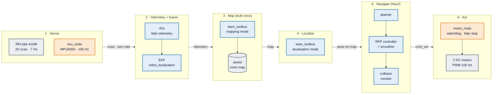
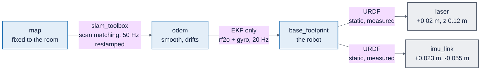

# CA3 presentation: slide outline (low-cost SLAM robot)

Status: **v4, 2026-11-11**: what SLAM is → sensors and literature → the robot → pipeline → one slide per pipeline block (built · result · challenges → fix) → result → analysis (why + unexpected) → future work and learnings. Only work that ran on the robot goes on a slide. The delivery mission is dropped (not achieved).

Brief (NTULearn): 10-15 min + 5 min Q&A, Thu Week 13 9:30-12:30; overview, state of the art, product/paper comparison, brief technical information, future trends; **most importantly our insights**; videos/animations ≤ 2 min in total; slides and report due end of Week 13; peer assessment confidential.

Presenters: **A**, **B**, **MT** (motor teammate), **S** (Sherman). Names to fill in.

Rules (AGENTS.md): every number is *measured*, *fitted* or *brief default* and points to its test_log row or notes block; papers only from [`literature_notes.md`](literature_notes.md) (verified), products only with a source ("to check"); no live demo.

**Title:** *A Low-Cost Autonomous SLAM Robot: What It Took to Map a Room and Navigate It*
**Main claim:** the SLAM and navigation software came as packages and worked. Almost every lost day was integration: cheap sensors, a loaded computer, power, motors, and a person standing behind the robot.

## 1. Slide table

Full implementation detail, every number with its command, and logs per block: [`implementation_by_block.md`](implementation_by_block.md). Same three-part layout on slides 8-13: **Built** (left) · **Result** (middle, one figure) · **Challenges → fix** (right). The pipeline sits small in the corner with the current block highlighted: `figures/2026-11-11_pipeline_block1.png` … `block6.png`.

| # | Section | Time | Who | Headline (the claim) | Visual | Speaker notes (numbers with source) |
| --- | --- | --- | --- | --- | --- | --- |
| 1 | Intro | 0:00-0:35 | A | We built a low-cost robot that maps a room and then drives itself around a box | Clip V1 (20 s) | - Pi 4B, RPLidar A1M8, MPU6050 IMU, two DC motors, **no wheel encoders** - Roadmap: what SLAM is → sensors and papers → the robot and its pipeline → each block: built, result, challenges → result → lessons |
| 2 | What is SLAM | 0:35-1:35 | A | SLAM answers two questions at once: what does the room look like, and where am I in it? | `figures/2026-11-11_drift_vs_slam.gif` (14 s: both paths grow over the saved map; odometry drifts up to 0.46 m off the SLAM path; still: `..._drift_vs_slam.png`) + `figures/2026-11-11_pose_graph.png` (our lap as a pose graph: 63 nodes, 6 revisits where loop closure can correct) | - The chicken-and-egg: a map needs a known position, a position needs a map; SLAM estimates both together - **Odometry** (how far did I move) drifts a little every step - **Scan matching** lines up each new scan with the map to correct it (front end) - **Loop closure** recognises a place seen before and corrects the whole path (back end, pose graph) - Filter-based vs graph-based; graph-based suits a robot without wheel encoders [R25] - Two modes: **mapping** (build once) and **localisation** (reuse) - The same problem every autonomous car solves with prior maps |
| 3 | Sensors | 1:35-2:10 | A | Two sensors: a spinning 2D lidar sees the room, an IMU feels the turns | Two cards: how each works, strengths, weaknesses | - Lidar: one plane, 360°, distance per ping; sees walls and legs, not tables above the plane; misses glass and dark surfaces - IMU (gyro + accelerometer): fast (100 Hz) and good at turns, drifts over time; no position on its own - Why both: lidar odometry is accurate but slow and fooled by moving things; gyro is fast and immune to the scene |
| 4 | Literature: methods we built on | 2:10-2:55 | S | We built on three published methods, and on sensors far cheaper than the papers used | Left: method chain J16 → robot_localization EKF → MJ21; right: table K26 / M26 / Y21 / ours: lidar, scan rate, IMU, wheel encoders, computer | - **Methods:** rf2o [J16] estimates planar motion from how consecutive lidar scans shift (range flow), standing in for wheel encoders; SLAM Toolbox [MJ21] builds a pose graph, closes loops, and relocalises on a saved map; the EKF fuses rf2o with the IMU. K26 runs exactly this chain - **Sensors:** K26: Ouster OS-1 (3D, cut to 2D), Jetson on board but all results replayed on a desktop; **no wheel encoders**, rf2o + robot_localization + SLAM Toolbox: the same stack as ours - M26: Hokuyo UTM-30LX, MicroStrain IMU, wheel encoders, PR2 dataset - Y21: Hokuyo UTM-30LX at 40 Hz - Ours (measured): A1M8 7.05 Hz, 26-29 % no-echo (C1); MPU6050 100 Hz, gyro z std 0.00175 rad/s at rest; Pi 4 at load 13-22 |
| 5 | Literature: what evaluations found | 2:55-3:45 | S | What the papers found, and what our robot showed | Four rows, paper → our result | - M26: fusing the IMU cut odometry error 60-75 % before SLAM, ≈0 after. Ours: gyro reads a hand turn as 360.2°, lidar odometry 352.9° (2 % short), so the IMU carries the heading - K26: SLAM Toolbox runs repeat within 0.20-0.23 m, measured by offline replay on a desktop. Ours: replaying one recording three times gave 0.68 / 0.59 / 0.53 m on the Pi (S8), so we tested live - Y21: people in the scan raise map error from 5.9 to 80 cm. Ours: a person behind the robot cut odometry to 25 % (S7), one stage earlier: [J16]'s range flow fits one rigid motion to the whole scan - S23: low-frequency 2D lidars skew scans while the robot moves. Ours: at 7 Hz the robot turns about 8° within one scan at 1 rad/s, a likely part of rf2o's 9-15 % under-read on fast turns (hypothesis) - **Our take:** published numbers come from good sensors and desktop replays; a cheap robot has to be measured live |
| 6 | The robot | 3:45-4:20 | MT | The robot: off-the-shelf parts on a two-wheel base | Robot photo, labelled | - Pi 4B, A1M8 on top (2 cm ahead of centre, in the URDF), MPU6050, motor driver + 2 DC motors, motor battery, Pi power bank, USB camera (Foxglove only), motor switch = kill switch - Cost: sum the BOM (to check) |
| 7 | Pipeline | 4:20-5:10 | MT | Six blocks, left to right: sense, odometry, map, localise, navigate, act | `figures/2026-11-11_pipeline.png` (overview), then `figures/2026-11-11_pipeline_detailed.png` (every node and topic: who reads `/scan`, `/imu/data`, `/odometry/filtered`) | - Walk the diagram once; each of the next six slides is one block - Orange = written by us (IMU node, motor node, plus URDF, launch files, tools); blue = ROS 2 packages (D5) - Foxglove to watch, rosbag2 to record |
| 8 | Block 1: sensing | 5:10-5:55 | B | One scan sees every nearby wall, but about 1 in 10 directions returns nothing | `figures/2026-11-11_scan_gaps.png` (one real scan on the room map at the robot's position: blue = what it saw, orange = no return) | **Built:** rplidar driver with `angle_compensate` on (720 beams); our `imu_node` (MPU6050 over I2C, 3 s still calibration at start, `/imu/recalibrate`); lidar and IMU positions measured into the URDF **Result:** lidar 7.05 Hz; in one scan 9 % of directions return nothing (26-29 % of raw pings; the driver fills some gaps by copying a neighbouring beam, so the published scan looks fuller); the scan lands on the map's walls; scale within 3.5 cm of tape; IMU 100 Hz, gyro z std 0.00175 rad/s at rest **Challenges → fix:** S1 gaps follow glass and dark surfaces → accepted, mapped anyway · C5 lidar start hang (`RPLIDAR running`, no S/N) → wait 20 s, one launch at a time · IMU calibration fails if the robot moves at start → hold still, restart |
| 9 | Block 2: odometry + fusion | 5:55-7:15 | S | Without wheel encoders the lidar is the odometry, and a person walking behind fooled it | `oi8_person_behind.gif` (15 s); small `turn_gyro_vs_rf2o.png` | **Built:** rf2o lidar odometry [J16] (`publish_tf: false`); covariance relay; EKF (robot_localization, 20 Hz) fusing rf2o velocity + gyro; the EKF alone publishes `odom → base_footprint` **Result:** 0.962 m on a 1.000 m push; hand turn gyro 360.2°, rf2o 352.9° **Challenges → fix:** S7 person behind → rf2o 24 % of the push; five hypotheses over three days, settled by counting scan points behind the robot (127-152 vs 16-18); 0.6 m range cut → 99.5 % offline · S8 three replays gave 0.68 / 0.59 / 0.53 m vs 0.96 m live → test live · S9 rf2o reports zero uncertainty → relay + fitted variances; fast turns under-read 9-15 %, [S23] scan skew a likely part (hypothesis) |
| 10 | Block 3: mapping | 7:15-8:15 | S | One hand-pushed lap made the map; loop closure is what made it usable | `map_build.gif` (14 s) → `2026-11-11_slam_sweep.png`; small `2026-11-11_beam_count.png` for S2 | **Built:** slam_toolbox [MJ21] in mapping mode; robot pushed round a taped loop (`mapping.launch.py`, 7 min); settings frozen in `slam_mapping.yaml` **Result:** 317 x 233 cells at 5 cm, 65.5 m² free; odometry alone doubles walls, SLAM keeps them single **Challenges → fix:** S2 `LaserRangeScan contains 1041 range readings, expected 931`, 223 scans rejected, a 184 x 112 fan → `angle_compensate` · S3 no ground truth → start-end gap on the mark as the metric: 0.109 m over 42 m with loop closure, **0.658 m without** · S4 `Failed to make transition 'TRANSITION_CONFIGURE'`, and a leftover process faked a pass → configure delayed 5 s, stale processes checked |
| 11 | Block 4: localisation | 8:15-9:00 | B | Localisation finds the robot within 3 cm, but only if it starts within 20° of the truth | `figures/2026-11-11_wrong_start.png`; `results/maps/2026-11-10_new_home.png` | **Built:** slam_toolbox localisation mode on the saved pose graph; start at a taped home pose (`map_start_pose`) **Result:** on the mark (-1.302, -0.307, 149.1°) vs (-1.3, -0.3, 151°), scan-to-map median 2.6 cm **Challenges → fix:** S5 `Starting localization at first node (dock) is correctly not supported` → `map_start_pose` · S6 wrong start 30 cm / 20° recovers, 31° never (matcher searches ±20°, needs 0.1 m of travel) → taped home mark · S11 old home 0.21 m from an obstacle → moved to 0.67 m clearance |
| 12 | Block 5: navigation | 9:00-10:00 | S | Nav2 failed seven ways before reaching a goal; SLAM's timing, not its accuracy, was one of them | `figures/2026-11-11_nav_goal_attempts.png` (ladder + evening goals); `results/maps/2026-11-10_home_clearance.png` small | **Built:** Nav2 on the saved map: planner, RPP controller, velocity smoother, collision monitor; our config in `nav2_params.yaml`, each fix guarded by a config test **Result:** `Goal succeeded` after 93 s, 1.5 m **Challenges → fix:** C8 Nav2 sent `Twist`, motor node expects `TwistStamped`, wheels silent → stamped · server timeout 20 → 1000 ms · S10 `Transform data too old when converting from map to odom` (0.37 s; slam_toolbox stamps by last scan, ≥ 0.5 s apart at load 13-22) → `restamp_tf`, tolerances 0.5 s · slowdown 0.045 m/s below the stall floor → removed · turn/approach ≥ 0.10 m/s · drove backwards → reversing off · final turn stalled → any heading accepted |
| 13 | Block 6: motors + power | 10:00-11:00 | MT | The wheels stall below 0.10 m/s and the battery lasts one run; both set the software's limits | `motor_curve.png` + `straights.png`; `figures/2026-11-11_safety_zones.png` for the safety contract | **Built:** `motor_node` (teammate): duty from the fitted line, kick-start, 0.5 s watchdog, lidar stop 0.20 m (tested at 0.155 m), stale-scan stop, `dry_run` default **Result:** 1 m straights 0.96, 1.06, 1.16 m (2 of 3 in ±10 cm) **Challenges → fix:** C9 robot curved 35-40°, would not start, then 1 kHz software PWM overshot 2-3x under CPU load → 100 Hz, fit speed = 2.46 x (duty - 0.078), kick 0.30 for 0.35 s · C10 loose wire rebooted the Pi · C13 battery fade 0.74 → 0.38 m · C11 under-voltage 67.5 % → power bank 0 % · C12 `dry_run` never passed on, "live" runs drove nothing → PR 42 |
| 14 | Result | 11:00-11:50 | MT | It works: a goal 1.5 m away reached on its own, and a box driven around | Clip V2 (45 s, 2x) + `figures/2026-11-11_goal_on_map.png` | - `Goal succeeded` after 93 s, (-1.35, -0.29) → (-2.67, 0.42) (`bt_navigator` log) - Box about 1 m ahead, path about 3.0 m (**by eye, tape TBD**) - 1 success of 6 goals that evening; the others cancelled by hand - **Our take:** one success proves the loop closes, not that it is reliable |
| 15 | Analysis: why + unexpected | 11:50-12:50 | B | Almost every challenge was integration, and most were surprises | `challenge_timeline.png` (top) + `figures/2026-11-11_root_cause.png` | - Timeline: nine checkpoints in three weeks, each blocked by something unplanned - Of the SLAM challenges S1-S11 only two are algorithm limits (matcher ±20° window, rf2o's still-world assumption); the rest: configuration, launch order, data format, timing, method - Robot side: cheap hardware, a loaded Pi, silent mismatches (`Twist` vs `TwistStamped`, `dry_run`) - Unexpected: the person (S7), the replays (S8), the silent failures, PWM under CPU load - **Our take:** package defaults assume better hardware (K26 replayed on a desktop, M26 on a PR2), so every default had to be re-earned |
| 16 | Future work + learnings | 12:50-13:45 | A | What we would do next, and what we learned | Two columns | **Future:** wheel encoders; a live range filter for people (`laser_filters`), or people tracking as in [Y21]; scan de-skewing from range data [S23]; hardware PWM; offload Nav2 or a faster computer; repeat runs, slam_toolbox vs AMCL; tests with people walking; camera + lidar fusion (trends: sourced only) **Learnings:** design a ground truth when you have none (the taped loop); test live, not on replays; a test that can pass on a leftover process is not a test; measure physical limits (stall floor, power, CPU) on day one; make silent failures loud |
| 17 | Verdict | 13:45-14:10 | A | A low-cost robot can map a room with SLAM and navigate it on its own, once every physical limit is measured and designed around | One sentence, large type | Close on the claim; thank you; questions |
| B1 | Backup | Q&A | all | Stack, TF tree, frozen config | TF tree, key YAML values | If asked |
| B2 | Backup | Q&A | all | Every number with its command | Table from test_log | If asked |
| B3 | Backup | Q&A | S | OI-8 and replay in numbers | `oi8_and_replay_bars.png` | If asked |
| B4 | Backup | Q&A | S | Planner paths on the saved map | `results/maps/2026-11-08_planner_paths.png` | If asked |

Timing: 17 slides end at 14:10 (50 s slack). Per presenter: A 0:00-2:10 + 12:50-14:10 (3 min 30 s); S 2:10-3:45 + 5:55-8:15 + 9:00-10:00 (4 min 55 s); MT 3:45-5:10 + 10:00-11:50 (3 min 15 s); B 5:10-5:55 + 8:15-9:00 + 11:50-12:50 (2 min 30 s).

## 2. Video and animation budget (≤ 120 s)

| Clip | Slide | Seconds | Source |
| --- | --- | --- | --- |
| V1 around the box, best 20 s | 1 | 20 | 2026-11-10 box video |
| `oi8_person_behind.gif` | 9 | 15 | `tools/analysis/slide_figs.py` |
| `drift_vs_slam.gif` | 2 | 14 | same |
| `map_build.gif` (from first motion, 8 fps) | 10 | 14 | same |
| V2 full box run at 2x | 14 | 45 | box video |
| **Total** | | **108** | 12 s spare; if tight, show the drift still instead of its GIF |

Local files, muted, captioned. No live demo.

## 3. Our take lines (≤ 20 words, fixed box at the bottom)

| Slide | Our take |
| --- | --- |
| 5 | Published numbers come from good sensors and desktop replays; a cheap robot has to be measured live. |
| 9 | Without encoders the lidar is the odometry, and anything moving with the robot fools it. |
| 12 | Navigation defaults assume motors that can crawl and a fast computer; ours had neither. |
| 14 | One success proves the loop closes, not that it is reliable. |
| 15 | Package defaults assume better hardware, so every default had to be re-earned. |

## 4. Gaps to close before rehearsal 1 (Wed 2026-11-11)

- [ ] Tape numbers for the box run (distance, sideways drift, box position and size); which launch it was
- [ ] Add the 2026-11-10 evening Nav2 runs to `docs/test_log.md` and a notes entry (slides 12, 14 cite them)
- [ ] Robot photo, labelled (slide 6); BOM cost (slide 6)
- [x] Pipeline PNG and six highlighted copies (`figures/2026-11-11_pipeline*.png`)
- [x] Drift vs SLAM (2), scan gaps (8), sweep + beam count (10), wrong start (11), goal attempts (12), root cause (15): `figures/2026-11-11_*`
- [x] Pose graph (2), safety zones (7, 13), goal on map (14)
- [ ] First "fan" map image from the Pi (`~/maps/2026-10-31_room*`, Pi offline 2026-11-11) for slide 10
- [ ] Sensor specs from datasheets (A1M8, MPU6050) if slide 3 quotes any; else measured values only
- [ ] Presenter names

## 5. Q&A prep

| # | Question | Draft answer |
| --- | --- | --- |
| 1 | Why only one successful goal? | The evening went on finding and fixing faults (slides 12, 13); once the loop closed we had a video and the battery gave about one run per charge. We claim the loop works, not a success rate. |
| 2 | Why no wheel encoders? | The kit did not have them; lidar odometry plus the IMU stood in, as in [K26]. OI-8 shows the cost, and encoders are first on the roadmap. |
| 3 | Why packages, not your own code? | D5: the brief allows them, and the hard part turned out to be integration anyway. Our own EKF and planner stay a documented fallback (`docs/system/07_ros_stack.md`). |
| 4 | Is a 2D lidar safe around people? | Not on its own: one plane only, 26-29 % no-echo on this unit. Mitigations: 0.15 m/s cap, 0.20 m lidar stop (tested), watchdog, physical kill switch. |
| 5 | How does this compare to a road AV? | Same SLAM loop, far smaller world: a mapped room at 0.15 m/s, 2D instead of 3D lidar. What transfers is the structure and the integration lessons. |
| 6 | What would you do differently? | Measure the motors' stall floor and the power supply on day one, and keep people out of the scan in odometry tests. Both cost days later. |
| 7 | Why did replay differ from live? | The Pi is CPU-bound; rf2o's work lands at different times on each replay (spread -12 %, about 71 % of live); slowing playback did not fix it. |
| 8 | Wasn't this meant to be a delivery robot? | It started as one. A delivery loop needs repeated goals and we reached one goal on the last evening, so we report what works: mapping, localisation and one navigation goal around an obstacle. |
| 10 | How did you judge the map without ground truth? | The lap starts and ends on one taped mark, so the start-end gap measures the error (0.109 m over 42 m; 0.658 m without loop closure). [F17] also proposes metrics for judging 2D maps against each other (to check which, full text not read). |
| 9 | Did you replicate the papers? | No: our hardware and setup differ too much (slide 4). We compare directions: M26's IMU gain, K26's replay method, Y21's people effect, each against something we measured. |

## 6. Design notes

- One idea per slide; the headline is the claim, the figure its evidence, notes the rest.
- Figures carry no titles or source lines: the slide headline is the title, the source goes in one small footer line on the slide.
- Every number carries a provenance tag (*measured*, *fitted*, *brief default*, *by eye*).
- Fixed "Our take" box, same place on every slide that has one. Colour-blind-safe palette; captions on clips.

## 7. Key challenges and checkpoints

From `notes/notes.md`, `docs/test_log.md`, `docs/CA3.md` (OI-n) and `docs/system/06_troubleshooting.md`.

### Checkpoints reached

| Date | Checkpoint | Proof |
| --- | --- | --- |
| 2026-10-21 | Lidar bring-up on the first Pi | notes 2026-10-20/21 |
| 2026-10-22 | Stack decided: ROS 2 packages, not our own maths (D5); stack installed on the new Pi | notes 2026-10-22 "D5" |
| 2026-10-31 | CP0 platform up: robot built, lidar and IMU measured into the URDF | test_log 2026-10-30/31 |
| 2026-10-31 | First room map saved, SLAM settings frozen | `results/maps/2026-10-31_room2.png` |
| 2026-11-01 | CP1 localisation on the map, wrong start 30 cm / 20° recovers | test_log 2026-11-01 "6.4" |
| 2026-11-03 | CP2 OI-8 explained (person behind the robot) | `evidence/lidar/2026-11-03_oi8_*.txt` |
| 2026-11-09 | Motors live, lidar stop tested, first 1 m straight (0.96 m) | test_log 2026-11-09 |
| 2026-11-10 | CP5 robot drives: 2 of 3 straights; Pi power stable | test_log 2026-11-10 CP5 rows |
| 2026-11-10 | Nav2 goal succeeded (1.5 m, 93 s); robot drives around a box | `bt_navigator` log, video (test_log row to add) |

### Challenges

Root cause groups (slide 11): **HW** cheap hardware, **CPU** loaded computer, **IF** silent interface mismatch, **ENV** environment/algorithm assumption, **PL** platform/process. Expected = we planned for something like it; unexpected = slide 12.

| # | Date | Symptom | Root cause | How we found it | Fix / status | Group | Expected? | Slide |
| --- | --- | --- | --- | --- | --- | --- | --- | --- |
| C1 | 10-21 | Lidar returns a distance for only a third of pings | Room surfaces (glass, dark): gaps move with the scene | White box test; near-return bins move between bags (OI-4) | Accepted; mapped anyway (26-29 % no-echo) | HW | yes | 4 |
| C2 | 10-22 | Brief's Pi offline; new Pi stopped answering SSH | Old box gone; new one set up from scratch | `tailscale status`, `nc -z` | Moved to `sherm-raspi` over Tailscale | PL | no | 8 |
| C3 | 10-22 | Plan said write our own EKF, A*, pure pursuit | Too much maths for the time | Decision review | D5: ROS 2 packages, our code is glue | PL | yes | 7 |
| C4 | 10-30 | slam_toolbox dropped every scan: `LaserRangeScan contains 1041 range readings, expected 931` | Varying beam count with `angle_compensate` off | Error text, beam counts per bag | `angle_compensate` true (720 beams) | IF | no | 11 |
| C5 | 11-01 | Launch looks up but no `/scan` | Lidar restarted too soon, or two launches overlapped | Repeated starts; process list | Wait 20 s, one launch at a time (OI-6) | HW | no | 8 |
| C6 | 11-01 to 11-03 | Odometry read 24-28 % of a hand push | A person behind the robot moved with it; rf2o assumes a still scene | Ruled out format, rate, CPU; counted points behind the robot | Explained; 0.6 m range cut fixes it offline (99.5 %) | ENV | no | 12 |
| C7 | 11-02 to 11-03 | Three replays of one recording: 0.679 / 0.592 / 0.531 m | Replay timing on a loaded Pi varies | Repeat replays at rates 1.0, 0.5, 0.25 | Test live; bags as evidence only | CPU | no | 5, 12 |
| C8 | 11-09 | Wheels would never move under Nav2, no error | Nav2 sent `Twist`, motor node expects `TwistStamped` | Nav2 source (`twist_subscriber.hpp`), `ros2 topic info -v` | `enable_stamped_cmd_vel: true` | IF | no | 12 |
| C9 | 11-09 | Curved 35-40°, would not start slowly, overshot 2-3x under load | Per-wheel gains; static friction; 1 kHz software PWM late under CPU load | Duty sweeps with the stack off, then loaded | PWM 100 Hz, refit, kick-start | HW, CPU | partly (PWM part no) | 9, 12 |
| C10 | 11-09 | Pi rebooted twice mid-run; wheels dead | Loose motor wire; battery sag | Uptime 1 min after each fault | Wire fixed; battery cycled (OI-9) | HW | yes | 9 |
| C11 | 11-09 to 11-10 | Nav2 shut down (`IS DOWN after not receiving a heartbeat`) | Pi under-voltage 67.5 % of samples, CPU throttled | `vcgencmd get_throttled` every 2 s | Power bank: 60 of 60 `0x0` (OI-10, OI-11) | HW, CPU | no | 9 |
| C12 | 11-10 | "Live" Nav2 runs drove nothing | `dry_run` not passed on; YAML default won | `ros2 param get /motor_node dry_run` = True | PR 42 | IF | no | 12 |
| C13 | 11-10 | Same command drove 0.84, 0.74, 0.38 m | Motor battery fades after one run | Successive runs | Cycle the battery each run | HW | yes | 9 |
| C14 | 11-10 | Nav2 goals aborted or crept, seven ways | Timeouts too short for the Pi, stale transforms, home near obstacles, speeds below the stall floor, reversing | Nav2 logs per goal, clearance map | Seven config fixes, then `Goal succeeded` | CPU, HW | partly | 10 |

Pattern: 1 of 14 is an algorithm assumption (C6); 13 are hardware, computer load, interfaces or process. 9 of 14 were unexpected. The SLAM challenges in full detail, with logs and step-by-step investigations: [`slam_challenges.md`](slam_challenges.md) (S1-S11).

## 8. Figures (no robot needed)

`.venv/bin/python tools/analysis/slide_figs.py` (bags in `../delivery_bot_pi_backup/bags`). Figures have no titles or source lines; sources below go in the slide footer. Bag-derived values match test_log: turn 360.2° / 352.9°, OI-8 wall 1.222 m vs rf2o 0.290 m, straights rf2o 0.741 / 0.386 / 1.088 / 1.175 m.

| Slide | File (`figures/2026-11-10_…`) | Footer source |
| --- | --- | --- |
| 10 | `map_build.gif`, `odom_vs_slam.png` | bag 2026-10-31_map_200956 |
| 9 | `turn_gyro_vs_rf2o.png` | bag 2026-10-31_turn_194945; test_log 2026-10-31 "3.2 spin only" |
| 15 | `challenge_timeline.png` | notes, test_log, CA3.md OI list |
| 13 | `motor_curve.png`, `straights.png`, `power.png` | notes 2026-11-09 (late), PR 38; test_log 2026-11-10 CP5 rows, power sampler and gate |
| 9 | `oi8_person_behind.gif` (still `_last.png`) | bag 2026-11-01_push_230535; test_log 2026-11-03 |
| B3 | `oi8_and_replay_bars.png` | test_log 2026-11-03 OI-8 and replay rows |
| 2 | `2026-11-11_drift_vs_slam.gif` / `.png` (saved map behind) | bag 2026-10-31_map_200956, live run: odometry-only path moved into the map frame at the first pose; start-end gap 0.36 m vs 0.20 m (the 0.109 m on slide 10 is the replay sweep's number) |
| 8 | `2026-11-11_scan_gaps.png` | bag 2026-10-31_map_200956, mid-lap scan placed at its SLAM pose (-2.36, 0.65) on the saved map: 9.3 % of 720 directions return nothing; raw ping-level 26-29 % (OI-4); test_log 2026-11-03 beam stats |
| 10 | `2026-11-11_slam_sweep.png` | test_log 2026-10-31 "5.5 sweep" |
| 10 | `2026-11-11_beam_count.png` | bags 2026-10-31_map_200132 (931-1048 beams, 99.95 % differ from the first) and _200956 (720 fixed) |
| 11 | `2026-11-11_wrong_start.png` | test_log 2026-11-01 "6.4 wrong start" rows (placements by ruler and eye) |
| 12 | `2026-11-11_nav_goal_attempts.png` | test_log 2026-11-10, handover, commits (ladder); `bt_navigator` logs 2026-11-10 (evening goals) |
| 15 | `2026-11-11_root_cause.png` | section 7, primary group per challenge |
| 2 | `2026-11-11_pose_graph.png` | same bag, SLAM path: a node every 0.5 m; orange links join nodes over 8 apart that come within 0.4 m (geometric revisits, an illustration, not slam_toolbox's own loop-closure list) |
| 7 | `2026-11-11_pipeline.png` | `figures/pipeline.mmd` + `mermaid_config.json`, rendered with `npx @mermaid-js/mermaid-cli@11.4.2 -p <puppeteer config pointing at the installed Chrome>` |
| 7 | `2026-11-11_pipeline_detailed.png` | `slide_figs.py fig_dataflow`: mermaid look (Arial, same colours), hand-placed in three rows; shared topics far from their source shown as `(source)` tags; topics from `base.launch.py`, `nav2_params.yaml` (controller → `/cmd_vel_nav` → smoother → `/cmd_vel_smoothed` → collision monitor → `/cmd_vel`) |
| 8-13 | `2026-11-11_pipeline_block1.png` … `block6.png` | same source, one block highlighted, the rest faded |
| 7, 13 | `2026-11-11_safety_zones.png` | `drivers.yaml` (lidar stop 0.20 m ±35°, watchdog, stale scan), `nav2_params.yaml` (stop polygon, robot radius 0.12, inflation 0.25) |
| 14 | `2026-11-11_goal_on_map.png` | `bt_navigator` log 2026-11-10 (start, goal, 93 s); 0.25 m keep-out from the saved map; the driven path was not recorded, so the line is straight |
| B1 | `tf_tree.mmd` (section 10) | URDF, `base.launch.py`, `slam_localization.yaml` |

Existing, reuse: `results/maps/2026-11-10_home_clearance.png` (slide 12), `results/maps/2026-11-10_new_home.png` (slide 11), `evidence/lidar/2026-10-21_composite_20revs.png` (slide 8), `results/maps/2026-11-08_planner_paths.png` (B4), `evidence/lidar/2026-10-21_composite_20revs.png` (slide 3 or 4).

## 9. Pipeline diagram (slide 7)

Source `report/figures/pipeline.mmd`; GitHub renders the block below. Orange = our code, blue = ROS 2 packages, grey = hardware and data.

## 10. Frame chain (backup B1)

Source `report/figures/tf_tree.mmd`. `base_link` (wheel-radius height) sits between `base_footprint` and the sensors in the URDF; left out here for clarity.

